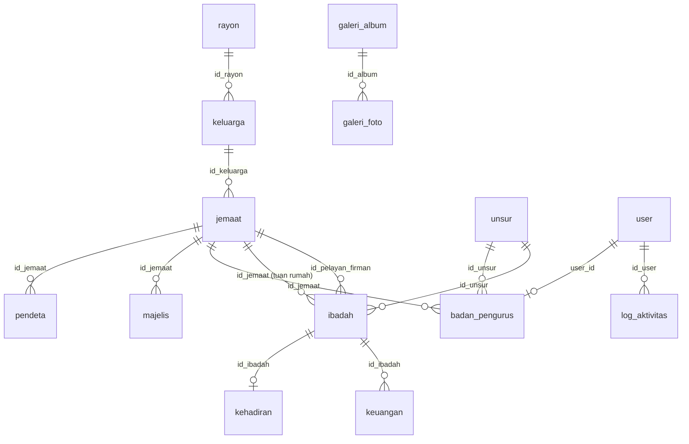

# 📊 DOKUMENTASI TABEL DATABASE — Sistem Informasi Jemaat GKI Syaloom Pasifik Indah

> **Gereja**: GKI Syaloom Pasifik Indah
>
> **Database**: MySQL — `TA_folen`
>
> **ORM**: Prisma. Setiap `id` menggunakan tipe `String` (CUID) yang dibuat otomatis, bukan angka auto-increment.

---

## Diagram Relasi Antar Tabel

---

## 1. `rayon` — Master Data Wilayah Rayon

**Fungsi**: Menyimpan data pembagian wilayah pelayanan jemaat (rayon). Ini adalah **data induk** yang berdiri sendiri dan menjadi acuan wilayah bagi tabel keluarga. Rayon melekat pada keluarga, sehingga seluruh anggota satu keluarga otomatis berbagi rayon yang sama.

| Nama Atribut | Tipe | Ukuran | Keterangan |
|---|---|---|---|
| `id` | VARCHAR (PK) | CUID | Primary key, dibuat otomatis |
| `nm_rayon` | VARCHAR | - | Unique — nama rayon. Contoh: Galilea, Yerikho, Bethel, Elim, Kana, Hermon, Bukit Zaitun |

**Peran dalam sistem**: Dikelola melalui modul `/admin/rayon` (tambah, ubah, hapus). Saat rayon dihapus, keluarga yang tertaut tidak ikut terhapus — kolom `id_rayon` pada keluarga di-set `NULL` (`onDelete: SetNull`). Karena berdiri sendiri, rayon sebaiknya diisi lebih awal sebelum mendata keluarga.

---

## 2. `keluarga` — Kartu Keluarga (Rumah Tangga Jemaat)

**Fungsi**: Menyimpan data satu rumah tangga yang menaungi beberapa jemaat. **Alamat dan rayon melekat pada keluarga**, sehingga seluruh anggota keluarga selalu berbagi alamat dan rayon yang sama. Kepala keluarga adalah anggota dengan status keluarga `KK`.

| Nama Atribut | Tipe | Ukuran | Keterangan |
|---|---|---|---|
| `id` | VARCHAR (PK) | CUID | Primary key, dibuat otomatis |
| `no_kk` | VARCHAR? | - | Nullable — Nomor Kartu Keluarga, unik bila diisi |
| `alamat_blok` | VARCHAR | - | Alamat/blok tempat tinggal. Contoh: G. 16, H. 04, B. 58 |
| `id_rayon` | VARCHAR? (FK) | CUID | Nullable — → `rayon.id`, rayon domisili keluarga |
| `created_at` | DATETIME | Auto | Waktu pembuatan data |
| `updated_at` | DATETIME | Auto | Waktu update terakhir (otomatis oleh Prisma) |

**Peran dalam sistem**: Dikelola melalui modul `/admin/keluarga`. Menjadi prasyarat pengisian Data Jemaat, karena setiap jemaat wajib memilih keluarga tempatnya bernaung. Relasi ke rayon bersifat opsional; jika rayon dihapus, `id_rayon` menjadi `NULL`.

---

## 3. `unsur` — Master Data Unsur Kategorial

**Fungsi**: Menyimpan data unsur kategorial gereja. **Data induk** yang berdiri sendiri dan menjadi acuan bagi kepengurusan (badan pengurus) serta ibadah unsur.

| Nama Atribut | Tipe | Ukuran | Keterangan |
|---|---|---|---|
| `id` | VARCHAR (PK) | CUID | Primary key, dibuat otomatis |
| `nm_unsur` | VARCHAR | - | Unique — nama unsur. Contoh: PKB, PW, PAM, Remaja, Tunas Anak |

**Peran dalam sistem**: Dikelola melalui modul `/admin/unsur` (tambah, ubah, hapus). Dibutuhkan saat mendata pengurus unsur di modul Pelayan & Pengurus dan saat menjadwalkan ibadah khusus unsur di modul Agenda. Sebaiknya diisi lebih awal.

---

## 4. `jemaat` — Data Anggota Jemaat

**Fungsi**: Menyimpan data pribadi setiap anggota jemaat. Menjadi **sumber data utama** bagi modul pelayanan (pendeta, majelis, pengurus) dan ibadah (tuan rumah, pelayan firman). Alamat dan rayon tidak disimpan di sini melainkan diturunkan dari keluarga.

| Nama Atribut | Tipe | Ukuran | Keterangan |
|---|---|---|---|
| `id` | VARCHAR (PK) | CUID | Primary key, dibuat otomatis |
| `id_keluarga` | VARCHAR? (FK) | CUID | Nullable — → `keluarga.id`, keluarga tempat bernaung |
| `nm_lengkap` | VARCHAR | - | Nama lengkap jemaat |
| `tgl_lahir` | DATE | - | Tanggal lahir |
| `jenkel` | VARCHAR | - | Jenis kelamin: `L` (Laki-laki) / `P` (Perempuan) |
| `stat_keluarga` | VARCHAR | - | Status dalam keluarga: `KK`, `Isteri`, `Anak`, `Lain_Lain` |
| `status` | VARCHAR | - | Status keanggotaan: `AKTIF`, `PINDAH`, `MENINGGAL`, `LAINNYA`. Default `AKTIF` |
| `created_at` | DATETIME | Auto | Waktu pembuatan data |
| `updated_at` | DATETIME | Auto | Waktu update terakhir (otomatis oleh Prisma) |

**Peran dalam sistem**: Dikelola melalui modul `/admin/jemaat`. Wajib memilih keluarga saat menambah data; alamat dan rayon otomatis mengikuti keluarga tersebut. Bila keluarga dihapus, anggota tidak ikut terhapus (`id_keluarga` menjadi `NULL`). Data jemaat yang aktif menjadi basis statistik dashboard dan daftar ulang tahun di Laporan.

---

## 5. `ibadah` — Jadwal Ibadah & Agenda Pelayanan

**Fungsi**: Menyimpan jadwal ibadah dan agenda pelayanan gereja, termasuk giliran tuan rumah, pelayan firman, dan detail liturgi. Menjadi induk bagi data Kehadiran dan Keuangan.

| Nama Atribut | Tipe | Ukuran | Keterangan |
|---|---|---|---|
| `id` | VARCHAR (PK) | CUID | Primary key, dibuat otomatis |
| `id_jemaat` | VARCHAR? (FK) | CUID | Nullable — → `jemaat.id`, tuan rumah/keluarga giliran. Rayon default diturunkan dari sini |
| `id_unsur` | VARCHAR? (FK) | CUID | Nullable — → `unsur.id`, bila ibadah khusus unsur tertentu |
| `id_pelayan_firman` | VARCHAR? (FK) | CUID | Nullable — → `jemaat.id`, pelayan firman dari data jemaat |
| `nm_ibadah` | VARCHAR? | - | Nullable — nama ibadah eksplisit; bila kosong diturunkan dari unsur/rayon/waktu |
| `gabungan` | BOOLEAN | - | Penanda ibadah gabungan di Gereja Syaloom. Default `false` |
| `sektor` | INT? | - | Nullable — sektor unsur (umumnya 1–10) |
| `tgl` | DATE | - | Tanggal pelaksanaan ibadah |
| `waktu` | TIME | - | Jam ibadah. Contoh: 05:30, 09:00 |
| `tempat` | VARCHAR? | - | Nullable — lokasi aktual bila dipindah. Kosong = di rumah tuan rumah |
| `alamat_tempat` | VARCHAR? | - | Nullable — alamat lokasi bila dipindah. Contoh: B. 33, C. 96 |
| `catatan` | VARCHAR? | - | Nullable — alasan pemindahan. Contoh: "Kel. A berhalangan" |
| `pelayan_firman` | VARCHAR? | - | Nullable — nama pelayan tamu (teks bebas) di luar data jemaat |
| `liturgos` | VARCHAR? | - | Nullable — petugas liturgos |
| `pembacaan_alkitab` | VARCHAR? | - | Nullable — perikop bacaan. Contoh: Markus 16:1-8 |
| `piket` | VARCHAR? | - | Nullable — petugas piket. Contoh: Majelis Rayon Hermon |
| `p_organ` | VARCHAR? | - | Nullable — pemain organ/keyboard |
| `created_at` | DATETIME | Auto | Waktu pembuatan data |

**Peran dalam sistem**: Dikelola melalui modul `/admin/agenda`. Pelayan firman diisi salah satu — dari data jemaat (`id_pelayan_firman`) atau nama tamu (`pelayan_firman`), tidak boleh keduanya. Agenda mendatang tampil di dashboard, dan setiap ibadah menjadi rujukan untuk mengisi Kehadiran dan Keuangan.

---

## 6. `kehadiran` — Statistik Kehadiran Ibadah

**Fungsi**: Menyimpan rekap jumlah kehadiran jemaat pada satu ibadah. Berelasi **satu-ke-satu** dengan ibadah (satu ibadah memiliki paling banyak satu data kehadiran).

| Nama Atribut | Tipe | Ukuran | Keterangan |
|---|---|---|---|
| `id` | VARCHAR (PK) | CUID | Primary key, dibuat otomatis |
| `id_ibadah` | VARCHAR (FK) | CUID | Unique — → `ibadah.id`, ibadah yang dihitung |
| `laki_laki` | INT | - | Jumlah hadir laki-laki. Default `0` |
| `perempuan` | INT | - | Jumlah hadir perempuan. Default `0` |
| `anak` | INT | - | Jumlah hadir anak. Default `0` |
| `total` | INT | - | Total kehadiran (akumulasi ketiga kategori). Default `0` |

**Peran dalam sistem**: Dikelola melalui modul `/admin/kehadiran`. Membutuhkan data ibadah lebih dahulu. Bila ibadah dihapus, data kehadiran ikut terhapus (`onDelete: Cascade`). Nilai kehadiran dipakai untuk menghitung persentase kehadiran di dashboard dan rekap di Laporan.

---

## 7. `keuangan` — Penerimaan & Persembahan

**Fungsi**: Menyimpan data penerimaan keuangan/persembahan gereja. Setiap catatan dapat dikaitkan ke sebuah ibadah untuk menandai kapan persembahan itu dikumpulkan.

| Nama Atribut | Tipe | Ukuran | Keterangan |
|---|---|---|---|
| `id` | VARCHAR (PK) | CUID | Primary key, dibuat otomatis |
| `id_ibadah` | VARCHAR? (FK) | CUID | Nullable — → `ibadah.id`, ibadah tempat persembahan dikumpulkan |
| `kategori` | VARCHAR | - | Kategori penerimaan: `TANGGUK`, `DIAKONIA`, `PENGUCAPAN_SYUKUR`, `PERSEPULUHAN`, `PEMBANGUNAN_RENOVASI`, `PENUNJANG_PELAYANAN`, `INKONVENSIONAL` |
| `nm_pemberi` | VARCHAR? | - | Nullable — nama pemberi. Contoh: Kel. Victor Pekpekay, atau "Yang tidak menyebut nama" |
| `jumlah` | INT | - | Nominal penerimaan (dalam Rupiah) |
| `keterangan` | TEXT | - | Nullable — penjelasan. Contoh: "Atas peneguhan sidi anak..." |
| `created_at` | DATETIME | Auto | Waktu pembuatan data |

**Peran dalam sistem**: Dikelola melalui modul `/admin/keuangan`. Kaitan ke ibadah bersifat opsional. Data ini menjadi bahan rekap keuangan di Laporan.

---

## 8. `pengumuman` — Warta & Pengumuman Jemaat

**Fungsi**: Menyimpan warta dan pengumuman untuk jemaat. Berdiri sendiri tanpa prasyarat data lain.

| Nama Atribut | Tipe | Ukuran | Keterangan |
|---|---|---|---|
| `id` | VARCHAR (PK) | CUID | Primary key, dibuat otomatis |
| `order` | INT | - | Urutan tampil. Default `0` |
| `judul` | VARCHAR | - | Judul pengumuman. Contoh: SAKRAMEN BAPTISAN KUDUS |
| `isi` | TEXT | - | Isi lengkap pengumuman |
| `tgl_publish` | DATETIME | - | Tanggal terbit. Default waktu pembuatan |
| `status` | BOOLEAN | - | `true` = aktif/tampil, `false` = tidak aktif. Default `true` |

**Peran dalam sistem**: Dikelola melalui modul `/admin/pengumuman`. Status menentukan apakah pengumuman ditampilkan kepada jemaat.

---

## 9. `renungan` — Renungan Harian

**Fungsi**: Menyimpan renungan harian yang dibagikan kepada jemaat. Berdiri sendiri tanpa prasyarat data lain.

| Nama Atribut | Tipe | Ukuran | Keterangan |
|---|---|---|---|
| `id` | VARCHAR (PK) | CUID | Primary key, dibuat otomatis |
| `judul` | VARCHAR | - | Judul renungan. Contoh: KEBANGKITAN BUKAN KONSPIRASI |
| `bacaan` | VARCHAR? | - | Nullable — ayat bacaan. Contoh: Matius 28: 1-15 |
| `kutipan` | TEXT | - | Nullable — teks penegas di bawah judul |
| `isi` | TEXT | - | Isi lengkap renungan |
| `sumber` | VARCHAR? | - | Nullable — sumber renungan. Contoh: HT/www.renunganharian.net |
| `tgl_publish` | DATE | - | Tanggal renungan diterbitkan |
| `created_at` | DATETIME | Auto | Waktu pembuatan data |
| `updated_at` | DATETIME | Auto | Waktu update terakhir (otomatis oleh Prisma) |

**Peran dalam sistem**: Dikelola melalui modul `/admin/renungan`. Diurutkan berdasarkan tanggal terbit untuk ditampilkan kepada jemaat.

---

## 10. `galeri_album` — Album Galeri Kegiatan

**Fungsi**: Menyimpan data album/kegiatan yang menampung banyak foto. Menjadi induk bagi tabel `galeri_foto`.

| Nama Atribut | Tipe | Ukuran | Keterangan |
|---|---|---|---|
| `id` | VARCHAR (PK) | CUID | Primary key, dibuat otomatis |
| `order` | INT | - | Urutan tampil manual. Default `0` |
| `judul` | VARCHAR | - | Judul album. Contoh: Ibadah Natal 2025 |
| `keterangan` | TEXT | - | Nullable — deskripsi album |
| `kategori` | VARCHAR? | - | Nullable — pengelompokan. Contoh: Ibadah, Baptisan, Natal, Paskah |
| `tgl` | DATE? | - | Nullable — tanggal kegiatan |
| `status` | BOOLEAN | - | `true` = tampil, `false` = disembunyikan. Default `true` |
| `created_at` | DATETIME | Auto | Waktu pembuatan data |
| `updated_at` | DATETIME | Auto | Waktu update terakhir (otomatis oleh Prisma) |

**Peran dalam sistem**: Dikelola melalui modul `/admin/galeri`. Album harus dibuat lebih dahulu sebelum foto dapat diunggah ke dalamnya.

---

## 11. `galeri_foto` — Foto dalam Album

**Fungsi**: Menyimpan satu berkas foto milik sebuah album. Setiap foto wajib berada dalam satu album.

| Nama Atribut | Tipe | Ukuran | Keterangan |
|---|---|---|---|
| `id` | VARCHAR (PK) | CUID | Primary key, dibuat otomatis |
| `id_album` | VARCHAR (FK) | CUID | → `galeri_album.id`, album pemilik foto |
| `url` | VARCHAR | - | Path/URL berkas gambar |
| `caption` | VARCHAR? | - | Nullable — keterangan per foto |
| `order` | INT | - | Urutan foto dalam album. Default `0` |
| `created_at` | DATETIME | Auto | Waktu pembuatan data |

**Peran dalam sistem**: Dikelola melalui modul `/admin/galeri`. Bila album dihapus, seluruh fotonya ikut terhapus (`onDelete: Cascade`).

---

## 12. `user` — Akun Akses Sistem

**Fungsi**: Menyimpan akun pengguna yang dapat masuk ke area admin beserta perannya. Menjadi pusat autentikasi dan otorisasi.

| Nama Atribut | Tipe | Ukuran | Keterangan |
|---|---|---|---|
| `id` | VARCHAR (PK) | CUID | Primary key, dibuat otomatis |
| `username` | VARCHAR | - | Unique — identitas login |
| `password` | VARCHAR | - | Kata sandi (tersimpan ter-hash) |
| `role` | VARCHAR | - | Peran akun: `ADMIN`, `KETUA_UNSUR`, `KOORDINATOR_UNSUR` |
| `created_at` | DATETIME | Auto | Waktu pembuatan akun |

**Peran dalam sistem**: Dikelola melalui modul `/admin/pengaturan` (Akun Akses). Peran `ADMIN` dibuat lewat seed/skrip, bukan form. Akun peran unsur wajib ditautkan ke satu badan pengurus (relasi satu-ke-satu). `ADMIN` berakses penuh; peran unsur dibatasi oleh tabel `role_permission`.

---

## 13. `role_permission` — Hak Akses per Peran

**Fungsi**: Mengatur, per peran, apa yang boleh dilihat, ditambah, diubah, atau dihapus pada tiap modul/resource admin. Hanya peran non-admin yang diatur di sini.

| Nama Atribut | Tipe | Ukuran | Keterangan |
|---|---|---|---|
| `id` | VARCHAR (PK) | CUID | Primary key, dibuat otomatis |
| `role` | VARCHAR | - | `KETUA_UNSUR` / `KOORDINATOR_UNSUR` |
| `resource` | VARCHAR | - | Kunci modul yang stabil. Contoh: `jemaat`, `agenda`, `keuangan` |
| `can_view` | BOOLEAN | - | Boleh melihat/membuka modul. Default `false` |
| `can_create` | BOOLEAN | - | Boleh menambah data. Default `false` |
| `can_update` | BOOLEAN | - | Boleh mengubah data. Default `false` |
| `can_delete` | BOOLEAN | - | Boleh menghapus data. Default `false` |
| `created_at` | DATETIME | Auto | Waktu pembuatan data |
| `updated_at` | DATETIME | Auto | Waktu update terakhir (otomatis oleh Prisma) |

**Constraint**: Satu baris izin unik per kombinasi `role` + `resource` (`@@unique([role, resource])`).

**Peran dalam sistem**: Dikelola melalui modul `/admin/otorisasi` (Hak Akses). Peran `ADMIN` sengaja **tidak** disimpan di sini karena selalu berakses penuh. Kunci `resource` mengacu ke daftar di `lib/permissions.ts` (bukan label tampilan) agar tahan rename. Nilai izin ini yang menentukan menu dan aksi yang terlihat bagi peran unsur.

---

## 14. `pendeta` — Riwayat Pelayanan Pendeta

**Fungsi**: Menyimpan riwayat pelayanan pendeta. Data pribadi (nama, keluarga, alamat) diambil dari data jemaat melalui relasi, bukan diketik ulang.

| Nama Atribut | Tipe | Ukuran | Keterangan |
|---|---|---|---|
| `id` | VARCHAR (PK) | CUID | Primary key, dibuat otomatis |
| `id_jemaat` | VARCHAR (FK) | CUID | → `jemaat.id`, orang yang menjabat |
| `gelar` | VARCHAR? | - | Nullable — gelar pelayanan. Contoh: Pdt., Pdt. Emeritus, Vikaris |
| `tgl_mulai` | DATE | - | Awal masa bakti |
| `tgl_selesai` | DATE? | - | Nullable — akhir masa bakti; kosong bila masih menjabat |
| `aktif` | BOOLEAN | - | Status pelayanan. Default `true` |
| `created_at` | DATETIME | Auto | Waktu pembuatan data |
| `updated_at` | DATETIME | Auto | Waktu update terakhir (otomatis oleh Prisma) |

**Peran dalam sistem**: Dikelola melalui modul `/admin/pelayanan` (jenis Pendeta). Membutuhkan data jemaat lebih dahulu.

---

## 15. `majelis` — Riwayat Pelayanan Majelis (Penatua & Syamas)

**Fungsi**: Menyimpan riwayat pelayanan majelis. Sama seperti pendeta, data pribadi diambil dari data jemaat.

| Nama Atribut | Tipe | Ukuran | Keterangan |
|---|---|---|---|
| `id` | VARCHAR (PK) | CUID | Primary key, dibuat otomatis |
| `id_jemaat` | VARCHAR (FK) | CUID | → `jemaat.id`, orang yang menjabat |
| `jabatan` | VARCHAR | - | `PENATUA` / `SYAMAS` |
| `tgl_mulai` | DATE | - | Awal masa bakti |
| `tgl_selesai` | DATE? | - | Nullable — akhir masa bakti; kosong bila masih menjabat |
| `aktif` | BOOLEAN | - | Status pelayanan. Default `true` |
| `created_at` | DATETIME | Auto | Waktu pembuatan data |
| `updated_at` | DATETIME | Auto | Waktu update terakhir (otomatis oleh Prisma) |

**Peran dalam sistem**: Dikelola melalui modul `/admin/pelayanan` (jenis Majelis). Membutuhkan data jemaat lebih dahulu.

---

## 16. `badan_pengurus` — Kepengurusan Unsur Kategorial

**Fungsi**: Menyimpan data kepengurusan tiap unsur kategorial (mis. Ketua PKB, Bendahara PW). Menghubungkan jemaat yang menjabat, unsur tempat menjabat, dan opsional akun akses.

| Nama Atribut | Tipe | Ukuran | Keterangan |
|---|---|---|---|
| `id` | VARCHAR (PK) | CUID | Primary key, dibuat otomatis |
| `user_id` | VARCHAR? (FK) | CUID | Nullable, Unique — → `user.id`, akun akses untuk pengurus ini (satu-ke-satu) |
| `id_jemaat` | VARCHAR (FK) | CUID | → `jemaat.id`, orang yang menjabat |
| `id_unsur` | VARCHAR (FK) | CUID | → `unsur.id`, unsur tempat menjabat |
| `sektor` | INT? | - | Nullable — sektor unsur (umumnya 1–10). Kosong = tingkat unsur, bukan per-sektor |
| `jabatan` | VARCHAR | - | Contoh: Ketua, Sekretaris, Bendahara, Wakil Ketua |
| `tgl_mulai` | DATE | - | Awal masa bakti |
| `tgl_selesai` | DATE? | - | Nullable — akhir masa bakti; kosong bila masih menjabat |
| `aktif` | BOOLEAN | - | Status kepengurusan. Default `true` |
| `created_at` | DATETIME | Auto | Waktu pembuatan data |
| `updated_at` | DATETIME | Auto | Waktu update terakhir (otomatis oleh Prisma) |

**Peran dalam sistem**: Dikelola melalui modul `/admin/pelayanan` (jenis Pengurus). Membutuhkan data jemaat dan unsur lebih dahulu. Relasi ke `user` bersifat opsional dan satu-ke-satu — inilah yang menjadi prasyarat pembuatan akun akses peran unsur. Bila akun dihapus, `user_id` menjadi `NULL` (`onDelete: SetNull`).

---

## 17. `log_aktivitas` — Jejak Audit Aktivitas

**Fungsi**: Mencatat **siapa** (akun user) melakukan **aksi apa** (tambah/ubah/hapus) terhadap **data apa** (entitas + id) dan **kapan**. Menyimpan snapshot username, peran, dan IP saat aksi terjadi agar tetap terbaca walau akun kelak diubah/dihapus.

| Nama Atribut | Tipe | Ukuran | Keterangan |
|---|---|---|---|
| `id` | VARCHAR (PK) | CUID | Primary key, dibuat otomatis |
| `id_user` | VARCHAR? (FK) | CUID | Nullable — → `user.id`, pelaku aksi |
| `username` | VARCHAR | - | Snapshot username pelaku saat aksi terjadi |
| `role` | VARCHAR? | - | Nullable — snapshot peran pelaku (`ADMIN` / `KETUA_UNSUR` / `KOORDINATOR_UNSUR`) |
| `aksi` | VARCHAR | - | `CREATE` / `UPDATE` / `DELETE` |
| `entitas` | VARCHAR | - | Model/tabel terkait. Contoh: Ibadah, Pengumuman, Renungan |
| `id_entitas` | VARCHAR? | - | Nullable — id baris yang terpengaruh |
| `ringkasan` | VARCHAR? | - | Nullable — label ringkas terbaca. Contoh: judul/nama ibadah |
| `detail` | TEXT | - | Nullable — cuplikan data (JSON) untuk kelengkapan |
| `ip` | VARCHAR? | - | Nullable — alamat IP pelaku |
| `created_at` | DATETIME | Auto | Waktu aksi terjadi |

**Peran dalam sistem**: Ditampilkan (hanya-lihat) melalui modul `/admin/log-aktivitas`. Data terbentuk otomatis seiring aktivitas pengguna. Bila akun user dihapus, jejak lognya tidak ikut terhapus — `id_user` di-set `NULL` (`onDelete: SetNull`), sedangkan `username` dan `role` tetap tersimpan sebagai snapshot.

---

## Ringkasan Peran (Enum `role`)

| Nilai | Keterangan |
|---|---|
| `ADMIN` | Akses penuh ke seluruh modul. Dibuat lewat seed/skrip, tidak diatur di tabel `role_permission` |
| `KETUA_UNSUR` | Peran unsur; akses dibatasi sesuai izin di `role_permission`. Wajib tertaut ke badan pengurus |
| `KOORDINATOR_UNSUR` | Peran unsur; akses dibatasi sesuai izin di `role_permission`. Wajib tertaut ke badan pengurus |

---

### Penjelasan Alur Pengisian Data

1. **Data induk**: buat `rayon` dan `unsur` (keduanya berdiri sendiri).
2. **Keluarga**: buat `keluarga`, opsional dikaitkan ke `rayon`.
3. **Jemaat**: masukkan `jemaat`, wajib memilih `keluarga` (alamat & rayon otomatis mengikuti).
4. **Pelayanan**: angkat jemaat menjadi `pendeta`, `majelis`, atau `badan_pengurus` (pengurus butuh `unsur`).
5. **Akun akses**: buat `user` peran unsur, tautkan ke `badan_pengurus`; atur izinnya di `role_permission`.
6. **Ibadah**: jadwalkan `ibadah` (pilih tuan rumah & pelayan dari `jemaat`, unsur bila perlu).
7. **Turunan ibadah**: catat `kehadiran` dan `keuangan` yang merujuk ke `ibadah`.
8. **Informasi & media**: `pengumuman`, `renungan`, serta `galeri_album` → `galeri_foto` dapat diisi kapan saja.
9. **Audit**: `log_aktivitas` terisi otomatis mengikuti setiap aksi tambah/ubah/hapus.
